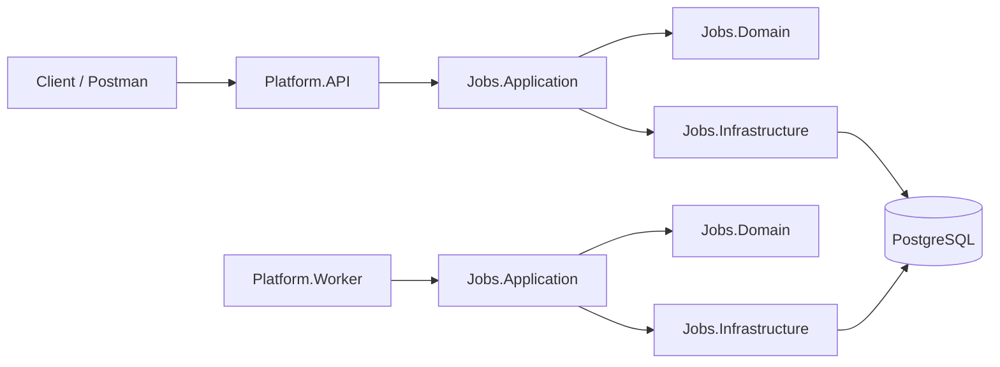
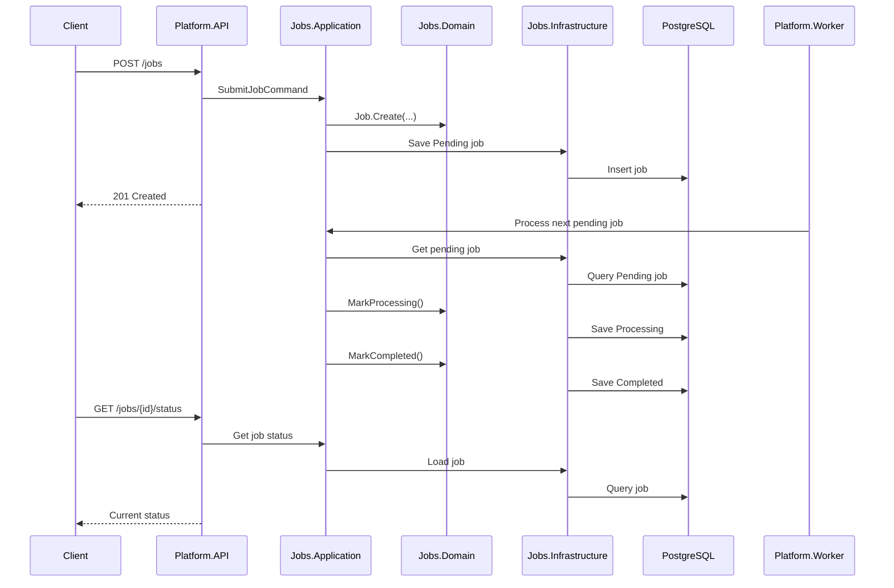
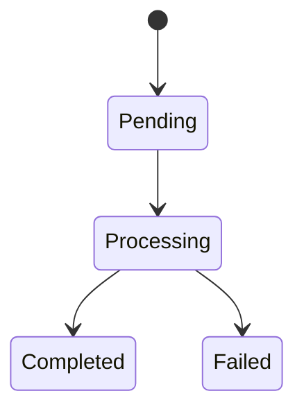

# Event Processing Platform

A simplified job-processing platform built with **C#/.NET**, **PostgreSQL**, and a **modular monolith** architecture.

The goal is to build a small but realistic backend system that demonstrates core distributed-system concepts without adding unnecessary complexity too early.

## What This Project Does

The MVP supports a simple job lifecycle:

```text
Submit Job -> Persist Job -> Process Job -> Update Status -> Query Status
```

A client submits a job through the API. The job is stored in PostgreSQL. A background worker picks up pending jobs, processes them, updates their status, and the client can query the current status.

## Current MVP Scope

In scope:

- Submit a job with `POST /jobs`
- Store jobs in PostgreSQL
- Process pending jobs with a background worker
- Update job status through a defined lifecycle
- Query job status with `GET /jobs/{jobId}/status`

Deferred until after the MVP:

- Redis
- Rate limiting
- Python AI service calls
- Queues
- Outbox pattern
- Retries
- Dead-letter queue
- Authentication
- Authorization
- k6 performance testing
- Advanced observability

## Current Implementation Status

Currently implemented:

- Repo scaffold
- Modular project structure
- Minimal API
- `GET /health`
- `POST /jobs`
- API -> Application -> Domain flow
- Job domain entity
- Job status enum
- Manual Postman testing

Not implemented yet:

- PostgreSQL persistence
- `GET /jobs/{jobId}/status`
- Worker processing
- Worker-driven status updates
- Failure handling

## Architecture Summary

This project uses a **modular monolith**.

The MVP focuses on the `Jobs` module only. Other modules exist as future extension points but are intentionally deferred.

### Main Projects

| Project | Responsibility |
|---|---|
| `Platform.API` | HTTP endpoints and request/response mapping |
| `Jobs.Application` | Use-case orchestration |
| `Jobs.Domain` | Job entity, status lifecycle, business rules |
| `Jobs.Infrastructure` | PostgreSQL/EF Core persistence |
| `Platform.Worker` | Background job processing |

## High-Level Architecture



## Runtime Flow



## Job Status Lifecycle



Allowed transitions:

```text
Pending -> Processing
Processing -> Completed
Processing -> Failed
```

The domain layer owns these transitions so status cannot be changed arbitrarily by the API, worker, or infrastructure code.

## Why PostgreSQL Polling First?

A more advanced version could use:

```text
API -> Database + Outbox -> Queue -> Worker
```

The MVP intentionally starts simpler:

```text
API -> PostgreSQL
Worker -> PostgreSQL polling
```

This proves the core lifecycle first:

```text
Submitted -> Persisted -> Processed -> Status Updated
```

Queues, outbox relay, retries, and dead-letter handling can be added later after the core loop works.

## Repository Structure

```text
src/
  Common/
    Application/
    Domain/
    Infrastructure/
    Observability/

  Modules/
    Jobs/
      Jobs.Application/
      Jobs.Contracts/
      Jobs.Domain/
      Jobs.Infrastructure/

    Tenants/
      Tenants.Application/
      Tenants.Contracts/
      Tenants.Domain/
      Tenants.Infrastructure/

    AI/
      AI.Application/
      AI.Contracts/
      AI.Infrastructure/

    RateLimiting/
      RateLimiting.Application/
      RateLimiting.Infrastructure/

  Platform/
    API/
    Worker/
    OutboxRelay/

ai-service/
.github/
  copilot-instructions.md
  specs/
Platform.sln
README.md
```

## API Endpoints

### `GET /health`

Returns API health.

Example response:

```json
{
  "status": "healthy"
}
```

### `POST /jobs`

Submits a new job.

Example request:

```json
{
  "tenantId": "11111111-1111-1111-1111-111111111111",
  "jobType": "ai.summary",
  "payload": "{\"text\":\"Summarize this content\"}"
}
```

Example response:

```json
{
  "jobId": "generated-guid",
  "tenantId": "11111111-1111-1111-1111-111111111111",
  "jobType": "ai.summary",
  "status": "Pending",
  "createdUtc": "timestamp"
}
```

### `GET /jobs/{jobId}/status`

Planned endpoint.

Expected response:

```json
{
  "jobId": "generated-guid",
  "status": "Pending",
  "createdUtc": "timestamp",
  "startedUtc": null,
  "completedUtc": null,
  "failedUtc": null,
  "failureReason": null
}
```

## Local Development

### Build

```bash
dotnet build
```

### Run API

```bash
dotnet run --project src/Platform/API/Platform.Api.csproj
```

The API runs on the configured local port, for example:

```text
http://localhost:5200
```

## Postman Testing

### Health Check

```text
GET http://localhost:5200/health
```

Expected response:

```json
{
  "status": "healthy"
}
```

### Submit Job

```text
POST http://localhost:5200/jobs
```

Header:

```text
Content-Type: application/json
```

Body:

```json
{
  "tenantId": "11111111-1111-1111-1111-111111111111",
  "jobType": "ai.summary",
  "payload": "{\"text\":\"Summarize this content\"}"
}
```

Expected result:

```text
201 Created
```

## Spec-Driven Development

This repo follows spec-driven development.

Project specs live in:

```text
.github/specs/
```

Current specs:

```text
project-scope.md
architecture.md
jobs-module.md
api-contracts.md
persistence.md
worker-processing.md
development-plan.md
```

AI coding assistants should follow:

```text
.github/copilot-instructions.md
```

## MVP Milestones

### 1. Current Vertical Slice

Status: mostly complete.

- `GET /health`
- `POST /jobs`
- API -> Application -> Domain flow
- Job creation
- `201 Created` response

### 2. PostgreSQL Persistence

Next milestone.

- Add EF Core PostgreSQL packages
- Create `JobsDbContext`
- Create repository abstraction
- Implement repository in `Jobs.Infrastructure`
- Persist submitted jobs
- Add migration

### 3. Job Status Endpoint

- Add status query application service
- Add `GET /jobs/{jobId}/status`
- Return current status
- Return `404` for missing jobs

### 4. Worker Processing

- Add background worker
- Poll PostgreSQL for pending jobs
- Mark jobs `Processing`
- Simulate work
- Mark jobs `Completed` or `Failed`

### 5. Documentation Cleanup

- Update README once the full MVP works
- Add final run instructions
- Add final Postman examples
- Document known limitations

## Design Philosophy

This project prioritizes:

- simple implementation first
- clean architecture boundaries
- durable persistence
- explicit domain lifecycle
- incremental development
- production-minded tradeoffs without premature complexity

The goal is not to build the most complex architecture possible. The goal is to build the smallest complete backend system that can be explained clearly in code reviews, interviews, and resume discussions.