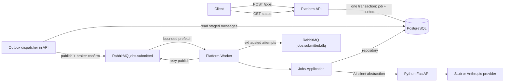

# Architecture

A modular monolith with two .NET hosts and one Python service. See [current state](current-state.md) for implemented features and [completion plan](completion-plan.md) for scope.

## Runtime Flow

## Responsibilities and Dependencies

| Layer | Responsibility |
| --- | --- |
| Platform.API | HTTP transport, tenant limiter, composition, optional startup migrations, hosted outbox dispatcher |
| Jobs.Application | Submission/status/processing use cases; repository, queue, AI and outbox abstractions |
| Jobs.Domain | Job invariants and lifecycle transitions; no framework dependencies |
| Jobs.Infrastructure | EF Core/Npgsql persistence, RabbitMQ publisher, HTTP AI client |
| Platform.Worker | RabbitMQ consumer host; calls application services and handles acknowledgement/outcome routing |
| ai-service | FastAPI analysis contract and swappable providers; no .NET LLM SDK calls |

Hosts reference Application and Infrastructure for DI wiring. Infrastructure implements Application abstractions and maps Domain entities. Application references Domain and Contracts, never either host. Domain must not reference EF Core, ASP.NET, PostgreSQL, HTTP or DI.

The Tenants, AI, and RateLimiting .NET module projects are scaffolding. Active behavior lives in Jobs, the hosts, and the Python service; these placeholder modules are not separate implemented subsystems.

## Persistence and Delivery Boundaries

Submission stages a job and its outbox message using the same scoped DbContext. One `SaveChangesAsync` commits both. The API dispatcher polls only the outbox; the worker consumes RabbitMQ and never polls PostgreSQL for jobs.

The dispatcher marks a row processed only after a confirmed, routable RabbitMQ publish. Broker outages leave it staged. A crash after publish confirmation but before the database update can cause another publish, so consumers must tolerate duplicate delivery.

The non-Pending status guard prevents sequential duplicates from repeating completed work. It is not an atomic claim for multiple workers. Retry/DLQ publishing is not transactional with job-state changes. Crash recovery of Processing jobs and coordination between multiple dispatcher/worker instances remain limitations; see the README.
