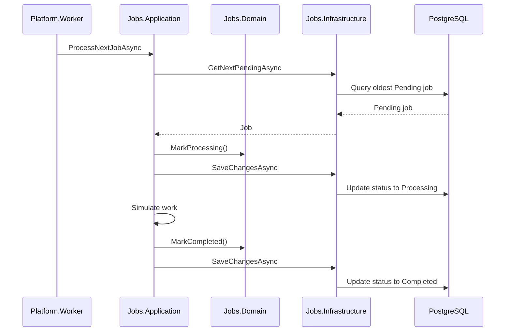

# Worker Processing

## Purpose

The Worker processes submitted jobs in the background.

For the MVP, the Worker polls PostgreSQL directly for pending jobs.

## Worker Goal

The Worker should:

1. Run continuously.
2. Look for pending jobs.
3. Mark a job as `Processing`.
4. Simulate work.
5. Mark the job as `Completed`.
6. Mark the job as `Failed` if processing throws.

## MVP Worker Flow



## No Job Available Flow

If no pending job exists:

1. Worker waits for a short interval.
2. Worker checks again later.

Example polling interval:

```text
2-5 seconds
```

## Failure Flow

If processing throws an exception:

1. Application catches the exception.
2. Domain marks job as `Failed`.
3. Failure reason is stored.
4. Changes are saved.

## Worker Rules

The Worker should:

- Use dependency injection.
- Call application services.
- Pass `CancellationToken`.
- Avoid direct EF Core usage.
- Avoid direct SQL usage.
- Avoid directly changing job status fields.
- Keep fake processing simple for MVP.

The Worker should not own domain rules.

## Application Processing Service

The Worker should eventually call an application service such as:

```text
IJobProcessingService
```

Expected behavior:

```text
ProcessNextJobAsync(CancellationToken cancellationToken)
```

Responsibilities:

- Find next pending job.
- Mark it Processing.
- Save.
- Simulate work.
- Mark it Completed.
- Save.
- Mark it Failed on error.

## Deferred Worker Features

Do not add these in the MVP:

- Queue consumption
- Outbox relay
- Distributed locks
- Parallel workers
- Retries
- Dead-letter queue
- AI service calls
- Metrics
- k6 testing
- Redis coordination

## Acceptance Criteria

Worker processing is complete when:

- API can submit a job.
- Job starts as `Pending`.
- Worker changes job to `Processing`.
- Worker changes job to `Completed`.
- `GET /jobs/{jobId}/status` reflects status changes.
- Worker can mark a failed job as `Failed`.