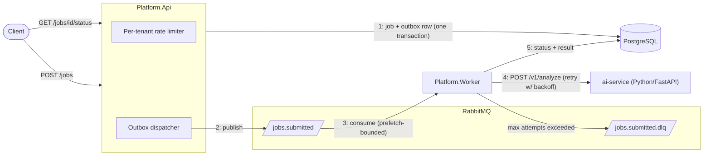

# Event Processing Platform

[](https://github.com/keagan-n/event-processing-platform/actions/workflows/ci.yml)

An event-driven job-processing platform built with **C#/.NET 10**, **PostgreSQL**, **RabbitMQ**, and a **Python/FastAPI AI service**, structured as a modular monolith. Jobs are submitted over HTTP, persisted with a PostgreSQL transactional outbox, dispatched through RabbitMQ, and analyzed by a worker calling Python/FastAPI. The demo includes bounded retries, a dead-letter queue, per-tenant rate limits, and consumer backpressure. The default analysis provider is a deterministic stub; Anthropic is an optional LLM provider.

The entire stack runs locally with one command and zero paid services.

```bash
docker compose --env-file .env.example up --build -d --wait
```

## Architecture



**Flow:** `POST /jobs` validates and persists the job **plus** an outbox row in a single PostgreSQL transaction. A background dispatcher publishes staged messages to RabbitMQ. The worker consumes with a bounded prefetch, loads the job by ID, and calls the Python AI service for analysis. Success stores the result; failure retries up to 3 attempts and then dead-letters. `GET /jobs/{id}/status` reads the outcome.

## Distributed-Systems Concepts Demonstrated

| Concept | Where |
| --- | --- |
| Transactional outbox (atomic job + message staging) | [JobSubmissionService](src/Modules/Jobs/Jobs.Application/JobSubmissionService.cs), [OutboxDispatcherService](src/Platform/API/OutboxDispatcherService.cs) |
| Publisher confirms and duplicate-delivery guard | [RabbitMqJobQueuePublisher](src/Modules/Jobs/Jobs.Infrastructure/Queue/RabbitMqJobQueuePublisher.cs), [JobProcessingService](src/Modules/Jobs/Jobs.Application/JobProcessingService.cs) |
| Retry with exponential backoff + jitter (transient HTTP) | [Worker Program.cs](src/Platform/Worker/Program.cs) (resilience handler on the AI client) |
| Message-level retry + dead-letter queue | [JobProcessingService](src/Modules/Jobs/Jobs.Application/JobProcessingService.cs), [JobSubmittedMessageConsumerService](src/Platform/Worker/JobSubmittedMessageConsumerService.cs) |
| Per-tenant rate limiting (token bucket, 429 + Retry-After) | [TenantRateLimiter](src/Platform/API/RateLimiting/TenantRateLimiter.cs) |
| Backpressure (bounded prefetch protecting downstream) | [JobSubmittedMessageConsumerService](src/Platform/Worker/JobSubmittedMessageConsumerService.cs) |
| Cross-language service boundary (LLM calls isolated in Python) | [ai-service](ai-service/), [HttpAiAnalysisClient](src/Modules/Jobs/Jobs.Infrastructure/AI/HttpAiAnalysisClient.cs) |
| Structured JSON logging | Serilog in [API](src/Platform/API/Program.cs) and [Worker](src/Platform/Worker/Program.cs) |

## Quickstart Demo

Prerequisites: Docker with Compose v2. Use the public example configuration for a free demo:

```bash
docker compose --env-file .env.example up --build -d --wait
```

This starts PostgreSQL, RabbitMQ (management UI at [localhost:15672](http://localhost:15672), guest/guest), the Python AI service, the API (migrations auto-applied), and the worker.

All published ports bind to `127.0.0.1`. The example passwords are public local-demo credentials. Use the stub with synthetic data; the API has no authentication. See [security checks and environment handling](SECURITY.md).

The hardened PostgreSQL Alpine and RabbitMQ 4 images use new volumes (`event_platform_postgres_alpine_data` and `rabbitmq_v4_data`). Older volumes remain intact, but their data will not appear in this demo. Back up/export old data before any migration; do not attach a RabbitMQ 3 volume directly to RabbitMQ 4.

Run the automated demo (Python 3.9+, no additional packages):

```bash
python3 scripts/smoke_test.py
# Also verify recovery after stopping/restarting the local broker:
python3 scripts/smoke_test.py --broker-outage --env-file .env.example
```

The checks use unique tenant IDs on each run and cover validation, the status route, completed analysis, retry exhaustion, DLQ delivery, 429/Retry-After, and tenant isolation. They assume the default three attempts and ten tokens per window. The outage option restarts RabbitMQ in a `finally` block. It creates demo jobs and leaves failed messages available for inspection.

**1. Submit a job and watch it complete with an analysis result:**

```bash
curl -s -X POST http://localhost:5200/jobs \
  -H "Content-Type: application/json" \
  -d '{"tenantId":"tenant-demo","jobType":"analysis","payload":"{\"text\":\"quarterly loan portfolio risk review\"}"}'

# Poll with the returned jobId — status becomes Completed with a result
curl -s http://localhost:5200/jobs/<jobId>/status
```

**2. Watch a failing job retry and dead-letter:**

```bash
curl -s -X POST http://localhost:5200/jobs \
  -H "Content-Type: application/json" \
  -d '{"tenantId":"tenant-demo","jobType":"analysis","payload":"{\"forceFailure\":true}"}'

# After ~5s: status shows Failed with attemptCount 2 (3 attempts total),
# and jobs.submitted.dlq holds one message (see the management UI → Queues).
```

**3. Trip the per-tenant rate limit (10 requests/minute per tenant):**

```bash
for i in $(seq 1 12); do
  curl -s -o /dev/null -w "%{http_code} " -X POST http://localhost:5200/jobs \
    -H "Content-Type: application/json" \
    -d '{"tenantId":"tenant-burst","jobType":"analysis","payload":"{\"n\":1}"}'
done
# → 201 ×10, then 429 with a Retry-After header. Other tenants are unaffected.
```

**4. Prove the outbox (submit during a broker outage):**

```bash
docker stop event-platform-rabbitmq
curl -s -X POST http://localhost:5200/jobs -H "Content-Type: application/json" \
  -d '{"tenantId":"tenant-outbox","jobType":"analysis","payload":"{\"text\":\"submitted during outage\"}"}'
# → 201. The job and its outbox row committed atomically.
docker start event-platform-rabbitmq
# ~20s later the dispatcher publishes the staged message and the job completes.
```

## Design Decisions

- **Modular monolith over microservices.** Module boundaries (Domain / Application / Infrastructure per module) give the architectural discipline of services without the operational overhead; the one real service boundary (Python AI service) exists because it isolates a different language runtime and failure domain.
- **Transactional outbox over publish-after-save.** The MVP originally published to RabbitMQ after the DB commit, which can silently lose dispatch if the broker is down. The outbox stages the message in the same transaction; an in-process dispatcher publishes it out-of-band. The publisher waits for RabbitMQ confirms before marking a staged message dispatched. A crash between confirmation and that update can cause duplicate delivery; the worker skips jobs that are already in a non-Pending state. This guard assumes one worker and is not a distributed lock.
- **Attempts tracked in PostgreSQL, not message headers.** The database is the system of record; a retry is a plain republish and the job row carries `attempt_count`. Simpler than header bookkeeping and survives broker restarts.
- **In-memory rate limiting over Redis.** A `PartitionedRateLimiter` token bucket per tenant is correct for a single API instance and is an honest answer at this scale; distributed rate limiting is listed as future work rather than prematurely built.
- **Thin messages (jobId only).** Consumers load state from the source of truth, so stale payloads in flight are impossible.
- **AI provider abstraction.** The Python service defaults to a deterministic stub (free, testable, CI-friendly); setting `AI_PROVIDER=anthropic` + an API key swaps in Claude without touching .NET.

## Known Limitations / Future Work

- Single API instance assumed for rate limiting (distributed limiter would need shared state).
- Retries redeliver immediately (in-process backoff already spaces real attempts); a TTL-based delayed-retry queue is a known upgrade.
- No distributed tracing (OpenTelemetry across the broker is the natural next step).
- Designed and demonstrated with one API/dispatcher and one worker. Multiple workers can race when loading a Pending job; the status guard is not an atomic claim.
- A worker crash or shutdown after persisting `Processing` can leave a job stranded. There is no lease/recovery mechanism yet.
- Initial submission is protected by the outbox. Retry/DLQ publication and job-state changes are separate operations; an infrastructure failure between them can lose a retry/dead letter. Unexpected consumer exceptions are nacked without requeue. This is not an exactly-once or end-to-end crash-recovery guarantee.
- `/health` is a liveness response, not a database/broker readiness probe. Compose waits for infrastructure health and the AI service before starting the worker.
- No auth by design — this project demonstrates processing patterns, not identity.

## Local Development (without containerized API/worker)

Prerequisites: .NET 10 SDK, Python 3.11 for Python development, and an EF CLI matching the EF Core 9 packages (`dotnet tool install --global dotnet-ef --version 9.0.0`). Create `.env` from `.env.example` if you do not already have one; its local database connection string must match `POSTGRES_*`.

```bash
docker compose up -d postgres rabbitmq ai-service   # infrastructure only
dotnet build src/Platform.sln
dotnet ef database update \
  --project src/Modules/Jobs/Jobs.Infrastructure/Jobs.Infrastructure.csproj \
  --startup-project src/Platform/API/Platform.Api.csproj --context JobsDbContext
dotnet run --project src/Platform/API/Platform.Api.csproj      # terminal 1
dotnet run --project src/Platform/Worker/Platform.Worker.csproj # terminal 2
```

## Tests

```bash
dotnet build src/Platform.sln
dotnet test src/Platform.sln          # 61 xUnit cases: domain, application, HTTP client, limiter
python3.11 -m venv ai-service/.venv
ai-service/.venv/bin/python -m pip install -r ai-service/requirements-dev.txt
(cd ai-service && .venv/bin/python -m pytest)  # 18 pytest cases
ai-service/.venv/bin/ruff check ai-service scripts
```

**79 passing xUnit/pytest cases** cover domain invariants, submission/outbox orchestration, processing and retries, request limits, the HTTP analysis contract, tenant budgets, and Python providers. These are unit/contract tests; the separate Compose smoke check exercises the real PostgreSQL, RabbitMQ, worker, and Python service together.

CI builds .NET, runs both suites and `ruff`, and runs the full Compose smoke check including a broker outage on pushes and pull requests to `main`. It also audits NuGet/Python dependencies, scans all five runtime images with Trivy, and scans Git history/current files with Gitleaks. Findings fail CI; see [SECURITY.md](SECURITY.md) for scope and local commands.

To stop the demo while preserving its database and queues:

```bash
docker compose --env-file .env.example down
```

## Repository Layout

```text
src/Modules/Jobs/        Jobs module: Domain, Application, Contracts, Infrastructure
src/Platform/API/        HTTP transport, rate limiting, outbox dispatcher
src/Platform/Worker/     RabbitMQ consumer host
src/Tests/               xUnit test projects
ai-service/              Python FastAPI analysis service (stub + Anthropic providers)
.github/specs/           Living specs: current state, completion plan, verification
```
